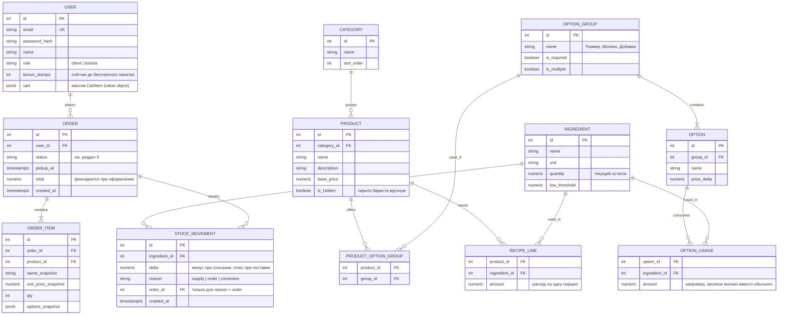
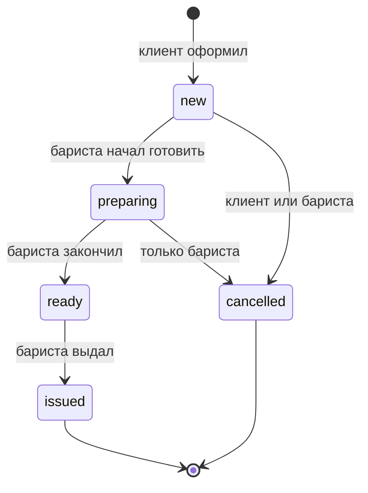

# Крема: наброски предметной области

Черновик для обсуждения. Всё, что помечено «решить», это развилки, которые выбираешь ты.

## 1. Сущности и связи

Что здесь не таблица:

- **CartItem** (продукт, выбранные опции, количество) лежит в `users.cart` как массив объектов. Цены в нём нет: она считается по текущему каталогу.
- **Доступность позиции** не хранится. Позиция недоступна, если скрыта вручную (`is_hidden`) или если для рецепта не хватает хотя бы одного ингредиента. Это считается запросом при чтении меню.

## 2. Агрегаты и их правила

| Агрегат | Состав | Правило, которое он защищает |
|---|---|---|
| **User** | поля пользователя, корзина (массив VO `CartItem`), `bonus_stamps` | позиции с одинаковым продуктом и опциями сливаются; бонусы только растут при выдаче заказа и обнуляются при использовании |
| **Order** | заказ и его `OrderItem` | статус двигается только по цепочке; итог равен сумме позиций; цены и названия фиксируются при оформлении |
| **Ingredient** | ингредиент и его остаток | остаток не уходит в минус; каждое изменение записывается в `StockMovement` |
| **Product** (каталог) | продукт, его опции и рецепт | у обязательной группы опций всегда есть значение по умолчанию |

Value objects: `CartItem`, `Options` (выбранные размер, молоко, доп. шот), деньги, интервал времени получения. Категории и группы опций это справочники, и отдельных агрегатов для них заводить не нужно.

**Один сценарий затрагивает два агрегата.** Когда бариста берёт заказ в работу, нужно сменить статус (`Order`) и списать ингредиенты (`Ingredient`). В монолите с одной БД это делает сервис приложения в одной транзакции (`pool.begin`). Агрегаты при этом друг на друга не ссылаются: сервис загружает оба и вызывает методы каждого.

## 3. Статусы заказа

| Переход | Кто | Побочный эффект |
|---|---|---|
| `new → preparing` | бариста | списание ингредиентов (решить: здесь или при оформлении) |
| `ready → issued` | бариста | +1 к `bonus_stamps` клиента, бесплатный напиток на каждый десятый |
| `new → cancelled` | клиент, бариста | ничего не списывалось, возвращать нечего |
| `preparing → cancelled` | только бариста | вернуть списанное через `StockMovement` (решить: возвращать или считать потерей) |

Соответствие с экранами: «Принят» у клиента это `new`, колонки очереди бариста это `new`, `preparing` и `ready`.

## 4. Решить самому

1. **Когда списывать остатки.** При оформлении (резерв, но тогда отмена должна возвращать), при начале приготовления (проще, но два клиента могут заказать последнюю порцию молока) или при выдаче (самое позднее, неудобно для стоп-листа).
2. **Бонус за отменённые заказы.** По схеме выше бонус начисляется только при выдаче, и отмена его не трогает. Бесплатный напиток помечается в заказе: нужна ли для него отдельная позиция или скидка на одну позицию.
3. **Время получения.** Что делать, если выбранное время уже прошло, а заказ в статусе `new`: напоминание бариста или автоотмена.
4. **Что считать «закончился ингредиент».** Ровно ноль или ниже порога `low_threshold`.
5. **Уведомления бариста.** Новые заказы приходят на экран очереди через `NOTIFY` и `Listener` (то, ради чего писался `Listener`) или обычным опросом раз в несколько секунд.

## 5. Минимальный набор для старта

Если нужно уложиться в срок, достаточно: `User`, `Category`, `Product`, `Option` с группами, `Order` с позициями и `Ingredient` с `StockMovement`. Рецепты и `OPTION_USAGE` (расход ингредиентов по опциям) можно добавить вторым этапом, а в первом считать, что напиток списывает фиксированный набор ингредиентов.